<p align="center"><a href="https://www.apostherapy.co.il">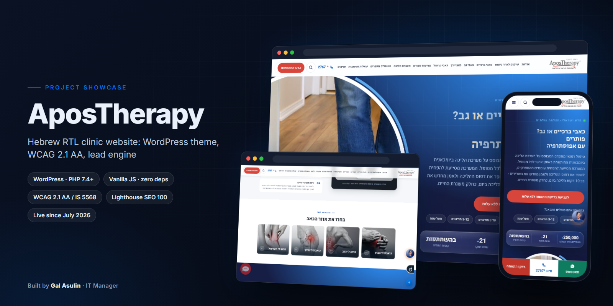</a></p>

<h1 align="center">AposTherapy · עיצוב ובנייה מחדש של האתר</h1>

<p align="center">ערכת עיצוב ל-WordPress, בעברית ומימין לשמאל, לרשת מרפאות פיזיותרפיה: מרונדרת בשרת, WCAG 2.1 AA, ומנוע לידים שמתחיל במייל.</p>

<p align="center"><a href="README.md">🇬🇧 English</a> · <a href="README.he.md">🇮🇱 עברית</a></p>

<div align="center">

[](https://www.apostherapy.co.il)


**[האתר החי](https://www.apostherapy.co.il) · [מסכים](#-מסכים) · [ארכיטקטורה](#-ארכיטקטורה) · [פרמטרים טכניים](#-פרמטרים-טכניים)**

</div>

<div dir="rtl" align="right">

> 🔒 **זו תצוגה ציבורית, לא קוד המקור.** הקוד של ערכת העיצוב וכל נתון אמיתי נשארים פרטיים. כל מה שכאן הוא סקירה ברמה גבוהה. כל פרטי הגישה, מפתחות ה-CRM והנתונים הפנימיים הוסרו, והם מוזנים דרך `wp-config.php`.

> 🚀 **באוויר מיולי 2026.** העיצוב החדש הוא היום האתר החי. הסימן הראשון מ-Google Search Console אחרי העלייה: **‎+15% בהקלקות האורגניות היומיות**, כשמספר החשיפות לא השתנה. זה שיפור מוקדם בשיעור ההקלקה, ועוד מוקדם לייחס אותו במלואו.

---

## 📋 במבט מהיר

| | |
|---|---|
| **סוג** | אתר בייצור · ערכת עיצוב ייעודית ל-WordPress (תיאור מקרה) |
| **סטטוס** | נמסר · באוויר מיולי 2026 |
| **טכנולוגיה** | WordPress · ‏PHP 7.4+ · ‏ES6 נקי · design tokens ב-CSS · ‏ACF · ‏Contact Form 7 |
| **התפקיד שלי** | עיצוב, פיתוח ומסירה, מקצה לקצה |
| **אתר חי** | [www.apostherapy.co.il](https://www.apostherapy.co.il) |
| **שפות** | האתר: עברית (RTL) · התיעוד: אנגלית / עברית |

---

## 📸 מסכים

<table>
<tr>
<td width="33%"><a href="docs/showcase/shots/home-desktop.png">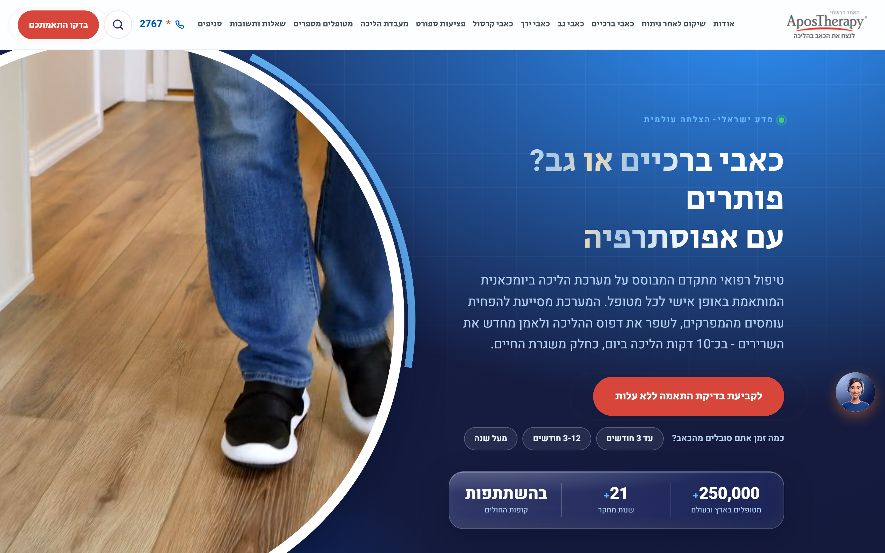</a><br><sub><b>דף הבית</b> · וידאו בכותרת, פס קופות החולים, כפתורי פעולה דביקים</sub></td>
<td width="33%"><a href="docs/showcase/shots/home-sections.png">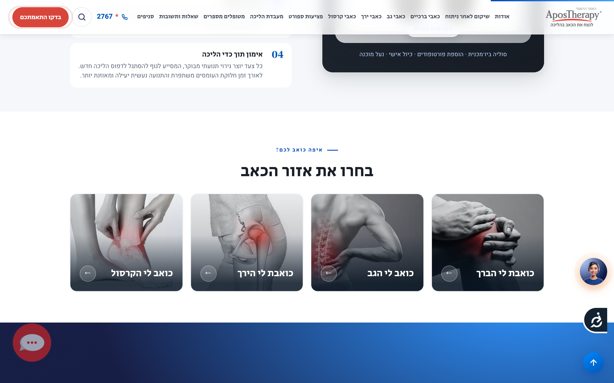</a><br><sub><b>הסקשנים של דף הבית</b> · חלק מרצף של 13 סקשנים</sub></td>
<td width="33%"><a href="docs/showcase/shots/quiz-modal.png">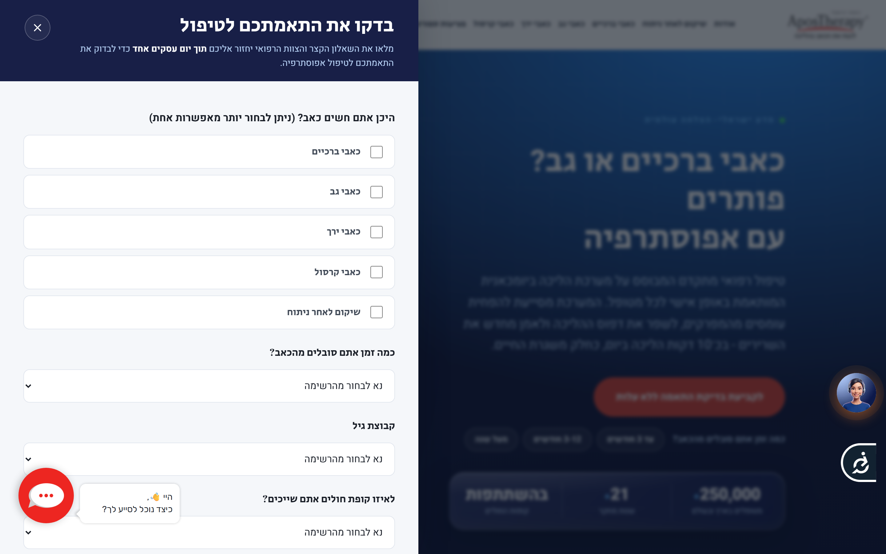</a><br><sub><b>שאלון "בדקו התאמתכם"</b> · סינון לידים בכמה שלבים</sub></td>
</tr>
<tr>
<td width="33%"><a href="docs/showcase/shots/condition-page.png">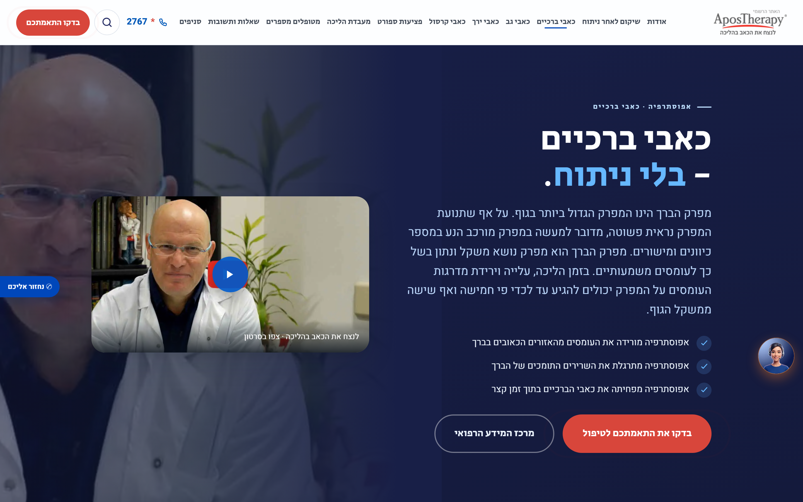</a><br><sub><b>עמוד מצב רפואי</b> · תבנית ייעודית לכל מצב</sub></td>
<td width="33%"><a href="docs/showcase/shots/faq-center.png">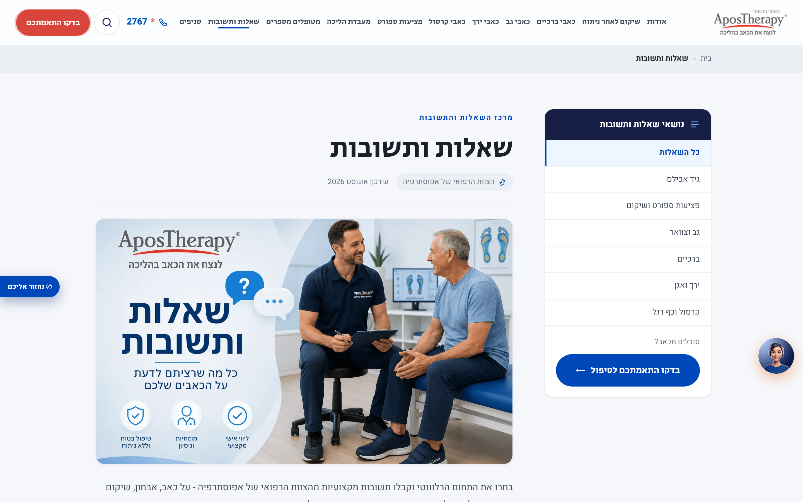</a><br><sub><b>מרכז שאלות ותשובות</b> · פריסת מאמר, מזין את <code>FAQPage</code></sub></td>
<td width="33%"><a href="docs/showcase/shots/assistant.png">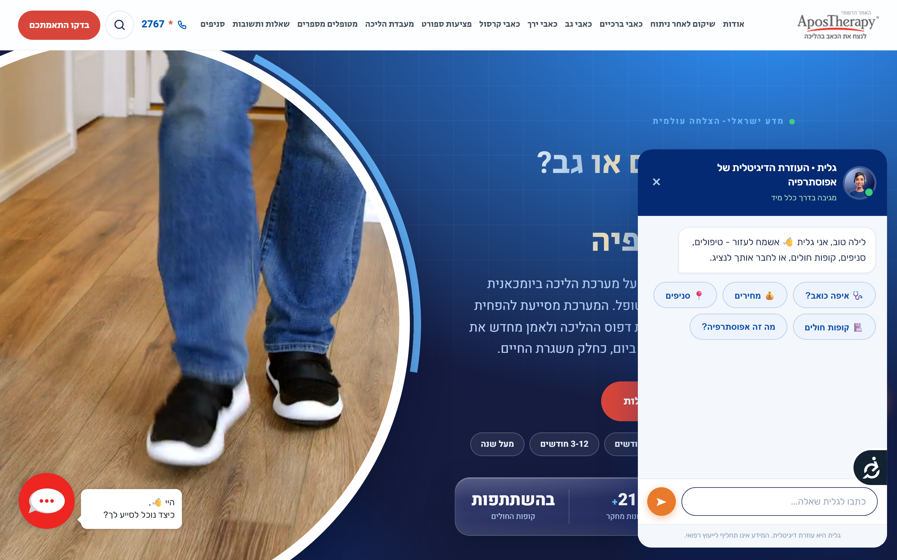</a><br><sub><b>העוזר באתר</b> · מקומי, בלי AI חיצוני</sub></td>
</tr>
</table>

<table>
<tr>
<td align="center"><a href="docs/showcase/shots/mobile-home.png">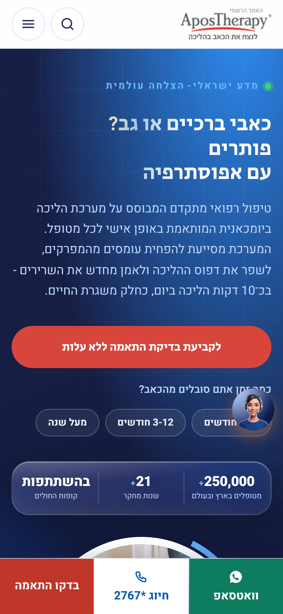</a><br><sub><b>דף הבית במובייל</b> · 390×844</sub></td>
<td align="center"><a href="docs/showcase/shots/mobile-menu.png">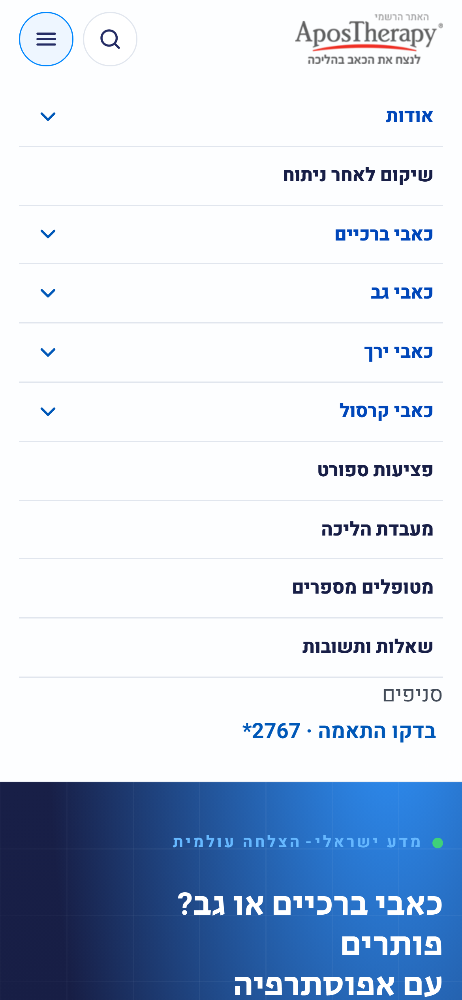</a><br><sub><b>התפריט במובייל</b> · ניווט מימין לשמאל</sub></td>
</tr>
</table>

---

## 🧭 מה זה

עיצוב ובנייה מחדש, מהיסוד, של האתר של רשת מרפאות פיזיותרפיה. האתר הקודם היה צריך מראה אחיד, נראות טובה יותר בחיפוש ודרך אמינה להפוך מבקרים ללידים. הפתרון הוא **ערכת עיצוב עצמאית ל-WordPress** שמותקנת *לצד* האתר הקיים ומשתמשת באותם סוגי תוכן, שדות ACF, תפריטים וחיבורי טפסים. כך אפשר היה לצפות בה על הדומיין החי ולהפעיל אותה **בלי הגירת נתונים ובלי רגע של השבתה**. שכבה אחת של design tokens מזינה כל סקשן, העמודים מרונדרים בשרת לטובת SEO, וכל מסלול ליד (שאלון, טפסים, טופס צף) עובר בצינור אחד שמתחיל במייל ורק אחר כך מסנכרן ל-CRM.

---

## 🧩 יכולות מרכזיות

| תחום | עיקר הדברים |
| ---- | ---------- |
| **מערכת עיצוב** | שכבת CSS של **design tokens** (משתני CSS לסולם של כחול מלכותי ולצבעים סמנטיים) שכל סקשן קורא ממנה · טיפוגרפיה זורמת עם `clamp()` · צמד גופנים שנבחר קודם לעברית (**Heebo** לגוף ו-**Secular One** לכותרות, `font-synthesis:none`) · ‏glassmorphism ו-`backdrop-filter` · **הטיה תלת-ממדית** עדינה במעבר עכבר · שפת רכיבים אחת לכל האתר |
| **דף הבית** | דף של **13 סקשנים** שמספר סיפור: כותרת עם **וידאו מושתק שמתנגן מעצמו**, פס קופות החולים, "איך זה עובד", ניווט לפי אזור הכאב, מעבדת ההליכה, פרסים, **פס נתונים תלת-ממדי מונפש**, סיפורי מטופלים, מסלול הטיפול, רשת מצבים רפואיים, הוכחה חברתית, מאמרים נבחרים וקריאה לפעולה בסוף |
| **המרה / שאלון** | **חלון "בדקו התאמתכם"** בכמה שלבים: שאלות מודרכות (אזור הכאב, משך הזמן, קבוצת גיל, קופת חולים) שהופכות מבקר אנונימי ל**ליד איכותי עם הקשר** · כפתורי פעולה בכותרת הדביקה ולאורך הדף · **טופס לידים צף שמופיע בגלילה**, עם תיבת הסכמה לדיוור |
| **מנוע הלידים** | **צינור אחד** לשאלון *ולכל* טופס יצירת קשר ← `admin-ajax` ← **מייל קודם** למרפאה, ו**סנכרון ל-CRM שלא חוסם** · ‏**honeypot** נסתר ו**הגבלת קצב לכל IP** · הסכמה קודם כול (תיבת הסכמה לדיוור לא מסומנת מראש בכל טופס) · כל ההגדרות ניתנות לדריסה ב-**filter** · **נקודת קצה ישנה** ומוקשחת נשארת פעילה בזמן רענון המטמון, כך ששום ליד לא הולך לאיבוד בזמן עדכון |
| **העוזר באתר ("גלית")** | **מקומי, בלי עלות שוטפת**: בלי API חיצוני של AI, בלי תשלום להודעה, ושום מידע של מבקר לא יוצא מהאתר · עונה על השאלות הנפוצות (טיפולים, קופות חולים, מחירים, סניפים, קביעת תור) מתוך מאגר ידע של **מילות מפתח ומילים נרדפות** · **העברה ל-WhatsApp או לשיחה בלחיצה** ומסלול **לכידת ליד** משלו · **מנוהל מתוך wp-admin** (מתג ראשי, תשובות ושאלות נפוצות שאפשר לערוך, ונתוני הסניפים נמשכים חי מהאתר) · שומר **שאלות שלא נענו** ומשוב 👍/👎 · מופיע **בכל האתר, כולל בעמודים עתידיים**, ומכבד את `prefers-reduced-motion` |
| **מרכז שאלות ותשובות** | מרכז **שאלות ותשובות** ייעודי ועוד **6 תת-נושאים** (גיד אכילס, פציעות ספורט ושיקום, גב וצוואר, ברכיים, ירך ואגן, קרסול וכף רגל), בעיצוב **המאמרים** של האתר: ניווט נושאים בצד, פירורי לחם, אקורדיונים מעוצבים ו**הופעה מדורגת בגלילה** · **התבנית נבחרת אוטומטית** לפי שם העמוד או כתובתו, כך שכל נושא עתידי יורש אותה · התוכן נשאר **ניתן לעריכה ב-wp-admin** (גוף העמוד / ACF) ו**מזין את סכמת `FAQPage`** שנוצרת אוטומטית |
| **נגישות** (WCAG 2.1 AA / ת"י 5568) | נבנה לפי **WCAG 2.1 AA / ת"י 5568** · קישור "דלג לתוכן" · אזורים סמנטיים · **ניווט מלא במקלדת** במגה-תפריט · ‏ARIA על הרכיבים האינטראקטיביים · כל אנימציה מאחורי `prefers-reduced-motion` · **ווידג'ט נגישות חיצוני** להתאמות של המבקר · תמונות בגודל הנכון (בלי קפיצות בפריסה) וטקסט חלופי שמתאר אותן |
| **ביצועים** | **טעינה מוקדמת של תמונת הכותרת (LCP)** · ‏DNS-prefetch · הסרת CSS מת · הסרה סלקטיבית של נכסים · וידאו שמתחיל מתמונה וטוען רק metadata · אפס הזזת פריסה מצטברת · JavaScript נקי שמונע מ-**IntersectionObserver**, כך ששום דבר לא רץ מחוץ למסך |
| **תנועה ומדיה** | **וידאו אווירה בכותרת** עם **התאוששות מחסימת ניגון אוטומטי** (ניסיון חוזר במגע הראשון, IntersectionObserver, ‏`visibilitychange` והשתקה כפויה), כך שהוא מתנגן גם ב**מצב חיסכון בסוללה של iOS או בחיסכון בנתונים** · אנימציות הופעה בגלילה · פעימת זוהר רכה על כפתורי הפעולה הראשיים. הכול נכבה כשהמכשיר של המבקר מבקש פחות תנועה (`prefers-reduced-motion`) |
| **אבטחה** | **כותרות אבטחה** בתשובות, מובנות בערכת העיצוב: **HSTS**, ‏`X-Content-Type-Options`, ‏`X-Frame-Options`, ‏`Referrer-Policy`, ‏`Permissions-Policy` · **אין סודות בערכת העיצוב**: כל פרט גישה נקרא מ-`wp-config.php` |
| **תוכן ותבניות** | שומרת על **סוגי התוכן** של האתר (סיפורי מטופלים, סניפי המרפאה), שדות **ACF** ותפריטים · תבניות ייעודיות לעמוד האודות (עם קורות החיים של המטפלים), לעמודי המצבים הרפואיים (ברך / גב / ירך …), למעבדת ההליכה, לתוכנית הביתית, ליצירת קשר, למחקר ולמפת האתר |
| **עלייה בלי סיכון** | מנגנון **תצוגה מקדימה חיה** מבוסס טוקן מציג את ערכת העיצוב החדשה **על הדומיין האמיתי** לאישור הלקוח (נשמר בעוגייה בין העמודים ועוקף את המטמון), **בלי להפעיל את הערכה** ובלי להשפיע על מבקרים אמיתיים · כל גרסה מעלה קבוע גרסה אחד, ש**גם מרענן את מטמון הנכסים** |

### חיפוש, נתונים מובנים ונראות במנועי AI

הנראות בחיפוש בנויה בתוך ערכת העיצוב עצמה, ולא מגיעה מתוסף. היא מורחבת גם ל**מנועי התשובות של AI**.

| שכבה | מה נבנה |
| ----- | -------------- |
| **נתונים מובנים** | ‏**JSON-LD של schema.org** שנכתב ביד: `MedicalClinic` ו-`LocalBusiness` (שם, טלפון, כתובות הסניפים, אזורי שירות), ‏`Organization`, ‏`Physician`, ‏`WebSite` (עם `SearchAction`), ‏`BreadcrumbList`, ‏`MedicalWebPage`, ובנוסף **`FAQPage` שנוצר אוטומטית** וקורא את האקורדיון בעמוד בזמן הרינדור. כך כל שאלה נפוצה, היום *ובעתיד*, מזינה את התוצאות העשירות של Google בלי תחזוקה |
| **מטא ושפה** | **כותרות ותיאורים** לכל עמוד, ‏**canonical** שמפנה לעצמו, ‏**hreflang** (`he` ו-`x-default`), ‏**Open Graph** מלא ו-Twitter `summary_large_image`, והנחיות robots ‏`max-image-preview:large` ו-`max-snippet:-1` בכל עמוד |
| **GEO / AIO** (חיפוש AI) | קובץ **`llms.txt`** מובנה למודלי שפה (סיכום השירותים, נקודות הוכחה, כל עמוד מפתח לפי קטגוריה), ו**רשימת היתרים מפורשת לסורקי AI** ב-`robots.txt` (GPTBot, ‏ClaudeBot, ‏PerplexityBot, ‏Google-Extended, ‏Applebot-Extended, ‏CCBot …), כדי שהמרפאה תוכל להופיע ב-**ChatGPT / Gemini / Perplexity** ובסקירות ה-AI של Google |
| **אינדוקס וגילוי** | מפות אתר XML (אינדקס, עמודים ומטופלים), מאומתות ב-**Google Search Console** וגם ב-**Bing Webmaster Tools**. בדיקת SEO חיה לכל עמוד אישרה מטא-דאטה ייחודית וממוקדת במילות מפתח בכל האתר |
| **אימות מייל** | ההגנה המלאה מפני התחזות, מוגדרת ב-DNS: **SPF + DKIM + DMARC** |

---

## 🧱 ארכיטקטורה

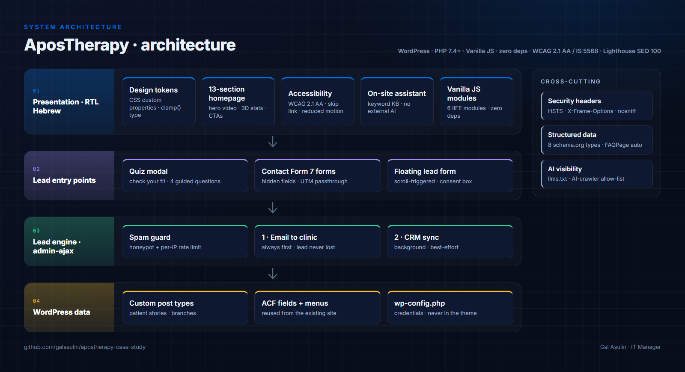

**ערכת עיצוב קלאסית ל-WordPress שמרונדרת בשרת** (בלי בונה עמודים ובלי פריימוורק בצד הלקוח), שיושבת מעל הנתונים הקיימים של המרפאה: סוגי תוכן, שדות ACF ותפריטים. שכבת התצוגה בנויה מתבניות PHP, משכבת design tokens ב-CSS וממודולי JavaScript נפרדים. כל מסלול ליד (חלון השאלון, כל טופס Contact Form 7 והטופס הצף שמופיע בגלילה) מגיע ל**נקודת קצה אחת** ב-`admin-ajax`. שם רצה קודם הגנה מספאם (honeypot נסתר והגבלת קצב לכל IP), אחר כך **נשלח מייל למרפאה**, ורק אז הליד נדחף ל-CRM ברקע. פרטי הגישה יושבים בקבועים של `wp-config.php`, אף פעם לא בערכת העיצוב, ואפשר לדרוס אותם דרך filter אחד של WordPress.

### זרימה

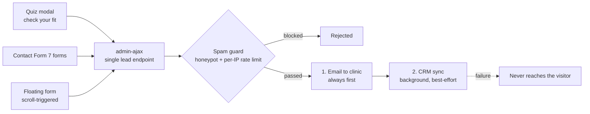

---

## 📐 פרמטרים טכניים

| פרמטר | ערך |
|---|---|
| פלטפורמה | WordPress, תבניות PHP קלאסיות, רינדור בשרת, בלי בונה עמודים |
| PHP | ‏7.4 ומעלה |
| JavaScript | ‏ES6 נקי במודולי IIFE נפרדים. אפס תלויות, אפס שלב בנייה |
| מודולי JS | ‏6 שהמבקר רואה: חלון השאלון, טופס הלידים הצף, התאוששות הניגון של וידאו הכותרת, גלילה חלקה לעוגנים, חזרה למעלה, מגה-תפריט במקלדת |
| עיצוב | ‏CSS של design tokens שנכתב ביד (משתני CSS), טיפוגרפיה זורמת עם `clamp()`, ‏RTL מלא |
| גופנים | ‏Heebo (גוף) ו-Secular One (כותרות), `font-synthesis:none` |
| דף הבית | ‏13 סקשנים |
| מרכז השאלות | מרכז אחד ועוד 6 תת-נושאים |
| נקודות כניסה ללידים | ‏3 (חלון השאלון, טופסי Contact Form 7, טופס צף) ← handler אחד של `admin-ajax` |
| הגנה מספאם | ‏honeypot נסתר והגבלת קצב לכל IP מבוססת transients |
| אינטגרציות | ‏Contact Form 7, ‏ACF, ה-CRM של המרפאה (הזרקת שדות נסתרים והעברת פרמטרי UTM) |
| נתונים מובנים | ‏8 סוגי schema.org: ‏`MedicalClinic`, ‏`LocalBusiness`, ‏`Organization`, ‏`Physician`, ‏`WebSite`, ‏`BreadcrumbList`, ‏`MedicalWebPage`, ‏`FAQPage` (נוצר אוטומטית) |
| hreflang | ‏`he` ו-`x-default` |
| כותרות אבטחה | ‏HSTS, ‏`X-Content-Type-Options`, ‏`X-Frame-Options`, ‏`Referrer-Policy`, ‏`Permissions-Policy` |
| נגישות | ת"י 5568 (WCAG 2.1 AA) · קישור דילוג · ניווט במקלדת · `prefers-reduced-motion` · ווידג'ט נגישות חיצוני |
| Lighthouse (באתר החי) | ‏SEO **100** · נגישות **97** · Best Practices **92** · ביצועים **89** במובייל / ~**97** במחשב |
| אינדוקס | **368 עמודים באינדקס**. מפות האתר תקינות ב-Google וב-Bing |
| אימות מייל | ‏SPF + DKIM + DMARC |
| הגירה / השבתה | אפס. נמסר לצד האתר הקיים |

### תוצאות

| מדד | תוצאה |
| ------ | ------ |
| **Lighthouse - SEO** | **100 / 100** |
| **Lighthouse - נגישות** | **97 / 100** |
| **Lighthouse - Best Practices** | **92 / 100** |
| **Lighthouse - ביצועים** | **89** במובייל · ~**97** במחשב |
| **תקן נגישות** | ת"י 5568 (WCAG 2.1 AA) |
| **לכידת לידים** | מייל קודם וסנכרון ל-CRM ברקע, עם הגנה מספאם |
| **הגירה / השבתה** | **אפס**. נמסר לצד האתר הקיים |
| **עלייה לאוויר** | **באוויר מיולי 2026**. היום זה האתר החי |
| **סימן אחרי העלייה** | **‎+15% בהקלקות האורגניות היומיות** בלי שינוי בחשיפות (מוקדם, עוד אי אפשר לייחס) |
| **אינדוקס** | **368 עמודים באינדקס**. מפות האתר תקינות ב-Google וב-Bing |
| **מוכנות לחיפוש AI** | ‏`llms.txt`, רשימת היתרים לסורקי AI ונתונים מובנים עשירים |
| **אימות מייל** | ‏SPF + DKIM + **DMARC** (הגנה מלאה מפני התחזות) |

---

## 🧠 החלטות הנדסיות

- **ערכת עיצוב עצמאית לצד האתר הקיים** ← משתמשת באותם סוגי תוכן, שדות ACF, תפריטים וחיבורי טפסים, ולכן אין הגירת נתונים ואין השבתה במעבר ← המחיר: הערכה החדשה חייבת להישאר תואמת למודל התוכן הקיים.
- **קודם לתפוס, אחר כך לסנכרן** ← המרפאה מקבלת כל ליד במייל לפני הקריאה ל-CRM, כך שתקלה ב-CRM לא מפילה ליד ← המחיר: הסנכרון ל-CRM נעשה ברקע ובמאמץ הטוב ביותר, והכישלונות שלו אף פעם לא מגיעים למבקר.
- **עוזר מקומי לפי מילות מפתח במקום API של AI** ← אין עלות להודעה ושום מידע של מבקר לא יוצא מהאתר ← המחיר: הוא עונה רק על מה שיש במאגר הידע, ולכן שאלות שלא נענו ומשוב 👍/👎 נשמרים כדי להרחיב אותו.
- **PHP מרונדר בשרת ו-JavaScript נקי, בלי בונה עמודים ובלי פריימוורק** ← HTML ידידותי ל-SEO, בלי עלות hydration, בלי שלב בנייה ובלי נעילה לספק ← המחיר: כל סוג עמוד הוא תבנית שנכתבה ביד.
- **בחירת תבנית לפי כתובת או שם העמוד** ← מרכז השאלות, תת-הנושאים וכל נושא עתידי מקבלים את פריסת המאמר בלי הגדרה ידנית ← המחיר: ההתאמה נשענת על מוסכמת שמות.
- **קבוע גרסה אחד לכל שחרור** ← העלאה שלו מרעננת גם את מטמון הנכסים, ונקודת קצה ישנה ומוקשחת לידים נשארת פעילה בזמן רענון המטמון ← המחיר: נקודת קצה נוספת נשמרת לזמן קצר אחרי כל עדכון.

משמעת מסירה: **בדיקת lint של PHP על כל תבנית** לפני האריזה, וחבילת מסירה ללקוח עם **מדריך התקנה** מאויר, **מפת דרכים לביצועים** ו**תוכנית פעולה ל-SEO / CRO**.

---

## 🚀 דפי נחיתה

שלושה דפי נחיתה לקמפיינים, שתכננתי ובניתי לרשת המרפאות לצד האתר הראשי. לכל אחד יש ריפו תצוגה משלו עם עותק חי לתיק העבודות (סטטי, בלי מעקב, וטופס הלידים מנותק):

| דף | מה מיוחד בו | ריפו | עותק חי |
|---|---|---|---|
| **דף המוצר APOS4** | מערכת APOS4 מתפרקת ומתחברת בחזרה תוך כדי גלילה: רצף פריימים דביק על canvas שמונע מהגלילה | [apos4-scroll-landing](https://github.com/galasulin/apos4-scroll-landing) | [לפתיחה](https://galasulin.github.io/apos4-scroll-landing/) |
| **דף מבוסס מחקר** | "87% דיווחו על פחות כאב": כותרת CSS תלת-ממדית שאפשר לגרור, מונים מונפשים, הופעה מדורגת בגלילה ושאלות נפוצות עם נתונים מובנים | [apostherapy-research-landing](https://github.com/galasulin/apostherapy-research-landing) | [לפתיחה](https://galasulin.github.io/apostherapy-research-landing/) |
| **דף ה-pods של APOS4 (גרסה ראשונה)** | ה-pods מתנתקים מהסוליה וחוזרים למיקום אישי תוך כדי גלילה: במה נעוצה שמונעת מ-`requestAnimationFrame` ומ-CSS transforms, על ארבעה גזירים אמיתיים של pods | [apos4-pods-landing](https://github.com/galasulin/apos4-pods-landing) | [לפתיחה](https://galasulin.github.io/apos4-pods-landing/) |

---

## 📁 מבנה הריפו

```
apostherapy-case-study/
├── README.md              English case study
├── README.he.md           Hebrew case study (RTL)
├── LICENSE                All rights reserved (presentation only)
└── docs/showcase/
    ├── hero.png           Header image
    ├── architecture.png   Architecture diagram
    └── shots/             Screenshots of the live site (desktop 1440×900, phone 390×844)
```

---

## 🔐 פרטיות והיקף

בכוונה, הריפו הזה **לא מכיל קוד מקור, פרטי גישה או נתונים אמיתיים**. הוא קיים כדי לתעד את הפרויקט ואת התפקיד שלי בתכנון, בבנייה ובמסירה שלו מקצה לקצה. פרטי המימוש זמינים לפי בקשה, במסגרת מתאימה. כל פרטי הגישה, מפתחות ה-CRM והנתונים הפנימיים הוסרו, והם מוזנים דרך `wp-config.php`. חומרי התצוגה הם © 2026 גל אסולין, כל הזכויות שמורות. ראו [LICENSE](LICENSE).

</div>

---

<div align="center"><b>Built by <a href="https://github.com/galasulin">Gal Asulin</a>, IT Manager</b></div>
