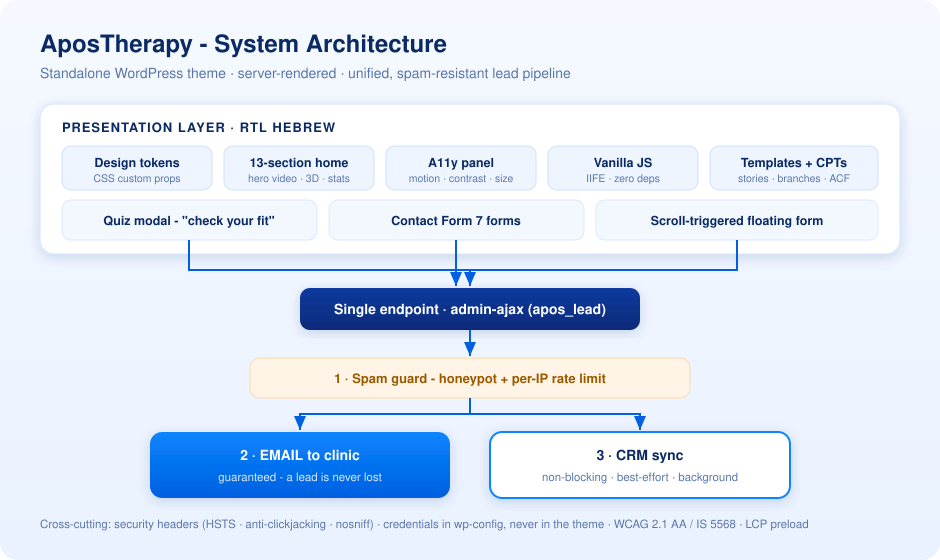
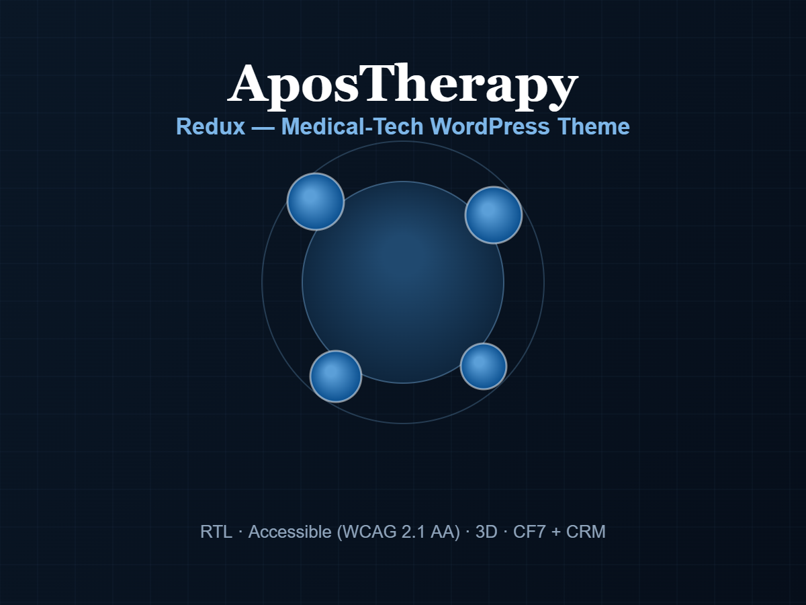

# 🩺 AposTherapy: עיצוב ובנייה מחדש של האתר · תצוגת פרויקט

**[🇬🇧 English](README.md) · [🇮🇱 עברית](README.he.md)**

אתר **בעברית, מימין לשמאל**, למרפאת פיזיותרפיה, שתכננתי ובניתי מקצה לקצה: ערכת עיצוב עצמאית ל-WordPress, עם ביצועים בראש סדר העדיפויות, שנבנתה לעמידה ב-WCAG 2.1 AA / ת"י 5568, ועם מנוע לידים אחד שמחבר מייל ו-CRM.

> 🔒 **זו תצוגה ציבורית, לא קוד המקור.** הקוד של ערכת העיצוב וכל נתון אמיתי נשארים פרטיים. כל מה שכאן הוא סקירה ברמה גבוהה. כל פרטי הגישה, מפתחות ה-CRM והנתונים הפנימיים הוסרו, והם מוזנים דרך `wp-config.php`.

> 🚀 **באוויר מיולי 2026.** העיצוב החדש הוא היום האתר החי. הסימן הראשון מ-Google Search Console אחרי העלייה: **‎+15% בהקלקות האורגניות היומיות**, כשמספר החשיפות לא השתנה. זה שיפור מוקדם בשיעור ההקלקה, ועוד מוקדם לייחס אותו במלואו.

---

## 📋 סקירה

עיצוב ובנייה מחדש, מהיסוד, של אתר מרפאת פיזיותרפיה. האתר נמסר כ**ערכת עיצוב עצמאית ל-WordPress** שמותקנת *לצד* האתר הקיים: היא משתמשת באותם סוגי תוכן, שדות ACF, תפריטים וחיבורי טפסים. כך אפשר היה לצפות בה על האתר החי ולהפעיל אותה **בלי שום הגירת נתונים ובלי רגע של השבתה**.

הרעיון המנחה הוא **מערכת עיצוב, לא עמודים בודדים**: שכבה אחת של design tokens מזינה כל סקשן, כך שהמראה נשאר אחיד וכל עמוד חדש יורש אותו מעצמו. האתר **מרונדר בשרת** לטובת SEO, **נבנה לעמידה** ב-WCAG 2.1 AA / ת"י 5568 (נגישות 97 ב-Lighthouse) ומכוון ל-**Core Web Vitals מהירים**.

הכול בנוי סביב מטרה אחת: להפוך מבקרים ללידים איכותיים, דרך **שאלון "בדקו התאמתכם"** מודרך ו**מנוע לידים אחד** ששולח כל פנייה במייל לפני שהוא מנסה לסנכרן אותה ל-CRM. את החוויה משלימים **עוזר צ'אט מקומי בלי עלות שוטפת** ו**מרכז שאלות ותשובות** ייעודי. שניהם בלי תלות בשירות חיצוני, נגישים, ושום מידע של מבקר לא יוצא מהאתר.

---

## 🏗️ ארכיטקטורה

**ערכת עיצוב קלאסית ל-WordPress שמרונדרת בשרת** (בלי בונה עמודים ובלי פריימוורק בצד הלקוח), מעל הנתונים הקיימים של המרפאה.

כל מסלול של ליד מתנקז ל**נקודת קצה אחת** (`admin-ajax`): חלון השאלון, כל טופס Contact Form 7 וטופס צף שמופיע בגלילה. שם רצה קודם הגנה מספאם (honeypot נסתר והגבלת קצב לכל IP), אחר כך **נשלח מייל למרפאה**, ורק אז הליד נדחף ל-CRM ברקע.

העיקרון: **קודם לתפוס, אחר כך לסנכרן.** המייל יוצא לפני כל דבר אחר, כך שתקלה ב-CRM לא יכולה להפיל ליד. הסנכרון ל-CRM נעשה במאמץ הטוב ביותר, והכישלונות שלו אף פעם לא מגיעים למבקר. פרטי הגישה יושבים בקבועים של `wp-config.php` (אף פעם לא בערכת העיצוב), ואפשר לדרוס אותם דרך filter אחד של WordPress.

---

## 🧩 מה יש בפנים

| תחום | עיקר הדברים |
| ---- | ---------- |
| **מערכת עיצוב** | שכבת CSS של **design tokens** (משתני CSS לסולם של כחול מלכותי ולצבעים סמנטיים) שכל סקשן קורא ממנה · טיפוגרפיה זורמת עם `clamp()` · צמד גופנים שנבחר קודם לעברית (**Heebo** לגוף ו-**Secular One** לכותרות, `font-synthesis:none`) · glassmorphism ו-`backdrop-filter` · **הטיה תלת-ממדית** עדינה במעבר עכבר · שפת רכיבים אחת, כך שכל האתר מרגיש שלם |
| **דף הבית** | דף נחיתה של **13 סקשנים** שמספר סיפור: כותרת עם **וידאו מושתק שמתנגן מעצמו**, פס קופות החולים, "איך זה עובד", ניווט לפי אזור הכאב, מעבדת ההליכה, פרסים, **פס נתונים תלת-ממדי מונפש**, סיפורי מטופלים, מסלול הטיפול, רשת של מצבים רפואיים, הוכחה חברתית, מאמרים נבחרים וקריאה לפעולה בסוף |
| **המרה / שאלון** | **חלון "בדקו התאמתכם"** במספר שלבים: שאלות מודרכות (אזור הכאב, משך הזמן, קבוצת גיל, קופת חולים) שהופכות מבקר אנונימי ל**ליד איכותי עם הקשר** · כפתורי פעולה בכותרת הדביקה ולאורך הדף · **טופס לידים צף שמופיע בגלילה**, עם תיבת הסכמה לדיוור |
| **מנוע הלידים** | **צינור אחד** לשאלון *ולכל* טופס יצירת קשר ← `admin-ajax` ← **מייל קודם** למרפאה, ו**סנכרון ל-CRM שלא חוסם** · ‏**honeypot** נסתר ו**הגבלת קצב לכל IP** חוסמים בוטים · הסכמה קודם כול (תיבת הסכמה לדיוור לא מסומנת מראש בכל טופס) · כל ההגדרות ניתנות לדריסה ב-**filter** · **נקודת קצה ישנה** ומוקשחת נשארת פעילה בזמן רענון המטמון, כך ששום ליד לא הולך לאיבוד בזמן עדכון |
| **העוזר באתר ("גל")** | עוזר צ'אט **מקומי, בלי עלות שוטפת**: **בלי API חיצוני של AI, בלי תשלום להודעה, ושום מידע של מבקר לא יוצא מהאתר**. הוא עונה על השאלות הנפוצות (טיפולים, קופות חולים, מחירים, סניפים, קביעת תור) מתוך מאגר ידע של **מילות מפתח ומילים נרדפות**, עם **העברה ל-WhatsApp או לשיחה בלחיצה** ומסלול **לכידת ליד** משלו · **מנוהל מתוך wp-admin** (מתג ראשי, תשובות ושאלות נפוצות שאפשר לערוך, ונתוני הסניפים נמשכים חי מהאתר) · שומר **שאלות שלא נענו** ומשוב 👍/👎, כך שמאגר הידע ממשיך להשתפר · מופיע **בכל האתר, כולל בעמודים עתידיים**, ומכבד הפחתת תנועה |
| **מרכז השאלות והתשובות** | מרכז **שאלות ותשובות** ייעודי ועוד **6 תת-נושאים** (גיד אכילס, פציעות ספורט ושיקום, גב וצוואר, ברכיים, ירך ואגן, קרסול וכף רגל), בעיצוב **המאמרים** של האתר: ניווט נושאים בצד, פירורי לחם, אקורדיונים מעוצבים ו**הופעה מדורגת בגלילה** · **התבנית מוחלת אוטומטית** (העיצוב הנכון נבחר לפי שם העמוד או כתובתו, כך שאין הגדרה ידנית לכל עמוד, וכל נושא עתידי יורש אותו) · התוכן נשאר **ניתן לעריכה ב-wp-admin** (גוף העמוד / ACF), והוא **מזין אוטומטית את סכמת `FAQPage`** לתוצאות העשירות של Google |
| **נגישות** (WCAG 2.1 AA / ת"י 5568) | **פאנל נגישות** למבקר: **הפחתת תנועה**, **ניגודיות גבוהה** ו**גודל טקסט**, וכל בחירה **נשמרת במכשיר** · קישור "דלג לתוכן" · אזורים סמנטיים · **ניווט מלא במקלדת** במגה-תפריט · כל אנימציה מאחורי `prefers-reduced-motion` · תמונות בגודל הנכון (בלי קפיצות בפריסה) וטקסט חלופי שמתאר אותן |
| **ביצועים** | **טעינה מוקדמת של תמונת הכותרת (LCP)** · ‏DNS-prefetch · הסרת CSS מת · וידאו שמתחיל מתמונה וטוען רק metadata · אפס הזזת פריסה מצטברת · JavaScript נקי שמונע מ-**IntersectionObserver**, כך ששום דבר לא רץ מחוץ למסך · ‏Lighthouse באתר החי: **SEO 100 · נגישות 97 · Best Practices 92 · ביצועים 89 במובייל / ~97 במחשב** |
| **תנועה ומדיה** | **וידאו אווירה בכותרת** עם **התאוששות עמידה מחסימת ניגון אוטומטי** (ניסיון חוזר במגע הראשון, IntersectionObserver, ‏`visibilitychange` והשתקה כפויה), כך שהוא מתנגן גם ב**מצב חיסכון בסוללה של iOS או בחיסכון בנתונים** · אנימציות הופעה בגלילה · פעימת זוהר רכה על כפתורי הפעולה הראשיים. הכול נכבה מיד כשהפחתת התנועה מופעלת |
| **אבטחה** | **כותרות אבטחה** בתשובות, מובנות בערכת העיצוב: **HSTS**, ‏`X-Content-Type-Options`, ‏`X-Frame-Options`, ‏`Referrer-Policy`, ‏`Permissions-Policy` · **אין סודות בערכת העיצוב**: כל פרט גישה נקרא מ-`wp-config.php` |
| **תוכן ותבניות** | שומרת על **סוגי התוכן** של האתר (סיפורי מטופלים, סניפי המרפאה), שדות **ACF** ותפריטים · תבניות ייעודיות לעמוד האודות (עם קורות החיים של המטפלים), לעמודי המצבים הרפואיים (ברך / גב / ירך …), למעבדת ההליכה, לתוכנית הביתית, ליצירת קשר, למחקר ולמפת האתר |
| **עלייה בלי סיכון** | מנגנון **תצוגה מקדימה חיה** מבוסס טוקן מציג את ערכת העיצוב החדשה **על הדומיין האמיתי**, כדי שהלקוח יאשר אותה. הבחירה נשמרת בעוגייה בין העמודים ועוקפת את המטמון, **בלי להפעיל את הערכה** ובלי להשפיע על מבקרים אמיתיים · כל גרסה מעלה קבוע גרסה אחד, ש**גם מרענן את מטמון הנכסים** |

---

## 🛠️ הטכנולוגיה וההנדסה

- **פלטפורמה:** WordPress עם **תבניות PHP קלאסיות** שנכתבו ביד. מרונדר בשרת (ידידותי ל-SEO, בלי עלות hydration), ‏PHP 7.4+, בלי בונה עמודים ובלי נעילה לספק.
- **עיצוב:** **מערכת CSS של design tokens** שנכתבה ביד (משתני CSS ← צבעים סמנטיים, ריווח וטיפוגרפיה זורמת). שליטה מלאה ב-**RTL**, טיפוגרפיה עם `clamp()`, **בלי ניפוח של מחלקות עזר**, וגופנים שנבחרו קודם לעברית (Heebo ו-Secular One).
- **JavaScript:** **ES6 נקי** ב**מודולי IIFE** נפרדים (חלון השאלון, פאנל הנגישות, טופס הלידים הצף, התאוששות הניגון של וידאו הכותרת, גלילה חלקה לעוגנים, חזרה למעלה, מגה-תפריט במקלדת). **אפס תלויות ואפס שלב בנייה**, שיפור הדרגתי, ו-`prefers-reduced-motion` מכובד בכל מקום.
- **צינור הלידים:** handler אחד של `admin-ajax`: **מייל קודם, CRM אחר כך**. ‏honeypot נסתר ו**הגבלת קצב לכל IP מבוססת transients**. הגדרות הספק בקבועים של `wp-config.php` וב-filter של WordPress, כך שהמפתחות אף פעם לא בקוד.
- **אינטגרציות:** **Contact Form 7**, ‏**ACF** וה-**CRM** של המרפאה. הם נשמרו מהמערכת המקורית, וחוברו דרך הזרקת שדות נסתרים והעברת פרמטרי UTM.
- **העוזר באתר:** וידג'ט צ'אט **מקומי, בלי תלויות**, שעובד לפי מילות מפתח ומילים נרדפות. **בלי AI של צד שלישי ובלי קריאות API החוצה.** מאגר הידע ניתן לעריכה בממשק הניהול, נתוני הסניפים נמשכים מהאתר, יש יומן של שאלות שלא נענו, ויש העברה ל-WhatsApp או לטלפון עם לכידת ליד.
- **אוטומציה של תוכן:** **נתב תבניות אוטומטי** מחיל את העיצוב הנכון על עמוד לפי הכתובת או השם (כך שמרכז השאלות וכל תת-נושא מקבלים את פריסת המאמר בלי שום הגדרה ידנית), והאקורדיונים בעמוד **מזינים אוטומטית את סכמת `FAQPage`**.
- **הנדסת נגישות:** מתגי העדפה שנשמרים ב-`localStorage`, שרשרת של הפחתת תנועה, ‏ARIA על הרכיבים האינטראקטיביים, וגדלי תמונות שלא מזיזים את הפריסה.
- **הנדסת ביצועים:** טעינה מוקדמת של ה-LCP, הסרה סלקטיבית של נכסים, ‏DNS-prefetch, ואסטרטגיית וידאו שמתחילה מתמונה.
- **משמעת מסירה:** **מקור אחד לגרסה ולרענון המטמון**, **בדיקת lint של PHP על כל תבנית** לפני האריזה, וחבילת מסירה ללקוח: **מדריך התקנה** מאויר במלואו, **מפת דרכים לביצועים** ו**תוכנית פעולה ל-SEO / CRO**.

---

## 🔍 הנדסת SEO · GEO · AIO

הנראות בחיפוש בנויה בתוך ערכת העיצוב עצמה, ולא מודבקת מבחוץ עם תוסף. היא מורחבת גם לדור החדש של **מנועי התשובות של AI**.

| שכבה | מה נבנה |
| ----- | -------------- |
| **נתונים מובנים** | ‏**JSON-LD של schema.org** שנכתב ביד: `MedicalClinic` ו-`LocalBusiness` (שם, טלפון, כתובות הסניפים, אזורי שירות), ‏`Organization`, ‏`Physician`, ‏`WebSite` (עם `SearchAction`), ‏`BreadcrumbList`, ‏`MedicalWebPage`. ובנוסף **`FAQPage` שנוצר אוטומטית** וקורא את האקורדיון בעמוד בזמן הרינדור, כך שכל שאלה נפוצה, היום *ובעתיד*, מזינה את התוצאות העשירות של Google בלי שום תחזוקה |
| **מטא ושפה** | **כותרות ותיאורים** לכל עמוד, ‏**canonical** שמפנה לעצמו, ‏**hreflang** (`he` ו-`x-default`), ‏**Open Graph** מלא ו-Twitter `summary_large_image`, והנחיות robots משופרות (`max-image-preview:large`, ‏`max-snippet:-1`) בכל עמוד |
| **GEO / AIO** (חיפוש AI) | מפת אתר מובנית **`llms.txt`** למודלי שפה (סיכום השירותים, נקודות הוכחה, כל עמוד מפתח לפי קטגוריה), ו**רשימת היתרים מפורשת לסורקי AI** ב-`robots.txt` (GPTBot, ‏ClaudeBot, ‏PerplexityBot, ‏Google-Extended, ‏Applebot-Extended, ‏CCBot …), כדי שהמרפאה תוכל להופיע ב-**ChatGPT / Gemini / Perplexity** ובסקירות ה-AI של Google |
| **אינדוקס וגילוי** | מפות אתר XML (אינדקס, עמודים ומטופלים), מאומתות ב-**Google Search Console** *וגם* ב-**Bing Webmaster Tools**. בדיקת SEO חיה לכל עמוד אישרה מטא-דאטה ייחודית וממוקדת במילות מפתח בכל האתר |
| **אימות מייל** | שלישיית ההגנה המלאה מפני התחזות, מוגדרת ב-DNS: **SPF + DKIM + DMARC** |

---

## 📈 תוצאות

| מדד | תוצאה |
| ------ | ------ |
| **Lighthouse - SEO** | **100 / 100** |
| **Lighthouse - נגישות** | **97 / 100** |
| **Lighthouse - Best Practices** | **92 / 100** |
| **Lighthouse - ביצועים** | **89** במובייל · ~**97** במחשב |
| **תקן נגישות** | ת"י 5568 (WCAG 2.1 AA) |
| **לכידת לידים** | מייל קודם וסנכרון ל-CRM ברקע, עם הגנה מספאם |
| **הגירה / השבתה** | **אפס**. נמסר לצד האתר הקיים |
| **עלייה לאוויר** | **באוויר מיולי 2026**. היום זה האתר החי |
| **סימן אחרי העלייה** | **‎+15% בהקלקות האורגניות היומיות** בלי שינוי בחשיפות (מוקדם, עוד אי אפשר לייחס) |
| **אינדוקס** | **368 עמודים באינדקס**. מפות האתר תקינות ב-Google וב-Bing |
| **מוכנות לחיפוש AI** | ‏`llms.txt`, רשימת היתרים לסורקי AI ונתונים מובנים עשירים |
| **אימות מייל** | ‏SPF + DKIM + **DMARC** (הגנה מלאה מפני התחזות) |

---

## 🖼️ צילומי מסך

---

## 🚀 דפי נחיתה

ארבעה דפי נחיתה לקמפיינים, שתכננתי ובניתי לרשת המרפאות לצד האתר הראשי. לכל אחד יש ריפו תצוגה משלו עם עותק חי לתיק העבודות (סטטי, בלי מעקב, וטופס הלידים מנותק):

| דף | מה מיוחד בו | ריפו | עותק חי |
|---|---|---|---|
| **דף המוצר APOS4** | מערכת APOS4 מתפרקת ומתחברת בחזרה תוך כדי גלילה: רצף פריימים דביק על canvas שמונע מהגלילה | [apos4-scroll-landing](https://github.com/galasulin/apos4-scroll-landing) | [לפתיחה](https://galasulin.github.io/apos4-scroll-landing/) |
| **דף מבוסס מחקר** | "87% דיווחו על פחות כאב": כותרת CSS תלת-ממדית שאפשר לגרור, מונים מונפשים, הופעה מדורגת בגלילה ושאלות נפוצות עם נתונים מובנים | [apostherapy-research-landing](https://github.com/galasulin/apostherapy-research-landing) | [לפתיחה](https://galasulin.github.io/apostherapy-research-landing/) |
| **דף לכידת לידים** | דף הקמפיין המקורי: טופס שתמיד גלוי במחשב, ובמובייל פס פעולה דביק וטופס במסך מלא | [apostherapy-lead-landing](https://github.com/galasulin/apostherapy-lead-landing) | [לפתיחה](https://galasulin.github.io/apostherapy-lead-landing/) |
| **דף ה-pods של APOS4 (גרסה ראשונה)** | ה-pods מתנתקים מהסוליה וחוזרים למיקום אישי תוך כדי גלילה: במה נעוצה שמונעת מ-`requestAnimationFrame` ומ-CSS transforms, על ארבעה גזירים אמיתיים של pods | [apos4-pods-landing](https://github.com/galasulin/apos4-pods-landing) | [לפתיחה](https://galasulin.github.io/apos4-pods-landing/) |

---

## 🔐 פרטיות והיקף

בכוונה, הריפו הזה **לא מכיל קוד מקור, פרטי גישה או נתונים אמיתיים**. הוא קיים כדי לתעד את הפרויקט ואת התפקיד שלי בתכנון, בבנייה ובמסירה שלו מקצה לקצה. פרטי המימוש זמינים לפי בקשה, במסגרת מתאימה.

---

<b>Built by <a href="https://github.com/galasulin">Gal Asulin</a>, IT Manager</b> 
תוכנן, פותח ונמסר על ידי <a href="https://github.com/galasulin">@galasulin</a> · Web &amp; IT.

