<p align="center"><a href="https://www.apostherapy.co.il">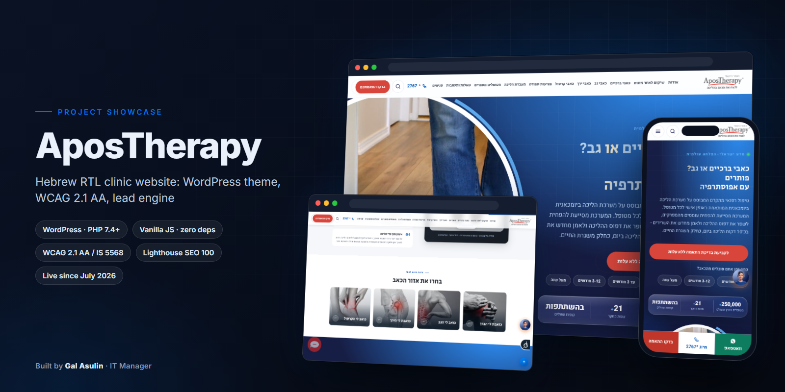</a></p>

<h1 align="center">AposTherapy · Website Redesign &amp; Build</h1>

<p align="center">A Hebrew RTL WordPress theme for a physiotherapy clinic network: server-rendered, WCAG 2.1 AA, email-first lead engine.</p>

<p align="center"><a href="README.md">🇬🇧 English</a> · <a href="README.he.md">🇮🇱 עברית</a></p>

<div align="center">

[](https://www.apostherapy.co.il)


**[Live site](https://www.apostherapy.co.il) · [Screens](#-screens) · [Architecture](#-architecture) · [Tech](#-technical-parameters)**

</div>

> 🔒 **This is a public showcase, not the source.** The theme's code and any real data are kept private. Everything here is a high-level overview; all credentials, CRM keys and internal data were removed and are supplied through `wp-config.php`.

> 🚀 **Live since July 2026.** The redesign is now the production site. Early post-launch signal from Google Search Console: **+15% daily organic clicks** at flat impressions. This is an early click-through-rate improvement; too soon to attribute fully.

---

## 📋 At a glance

| | |
|---|---|
| **Type** | Production website · custom WordPress theme (case study) |
| **Status** | Delivered · live since July 2026 |
| **Stack** | WordPress · PHP 7.4+ · vanilla ES6 · CSS design tokens · ACF · Contact Form 7 |
| **My role** | Design, development and delivery, end to end |
| **Live demo** | [www.apostherapy.co.il](https://www.apostherapy.co.il) |
| **Languages** | Site: Hebrew (RTL) · Docs: English / Hebrew |

---

## 📸 Screens

<table>
<tr>
<td width="33%"><a href="docs/showcase/shots/home-desktop.png">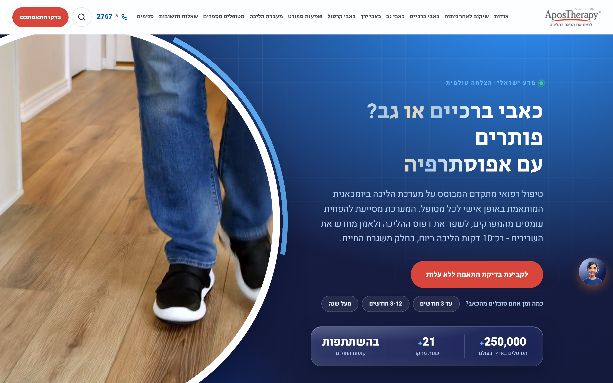</a><br><sub><b>Homepage</b> · hero video, health-fund trust bar, sticky CTAs</sub></td>
<td width="33%"><a href="docs/showcase/shots/home-sections.png">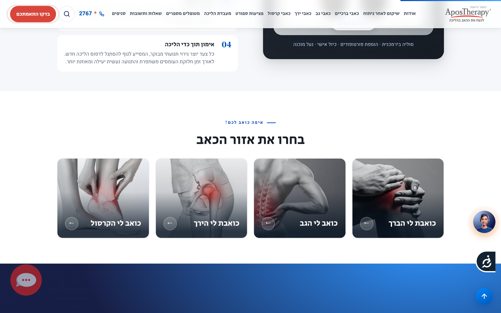</a><br><sub><b>Homepage sections</b> · part of the 13-section narrative</sub></td>
<td width="33%"><a href="docs/showcase/shots/quiz-modal.png">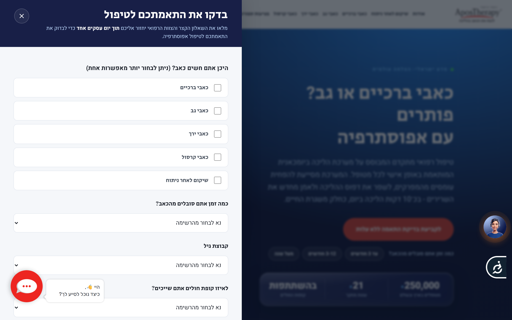</a><br><sub><b>"Check your fit" quiz</b> · multi-step lead qualification</sub></td>
</tr>
<tr>
<td width="33%"><a href="docs/showcase/shots/condition-page.png">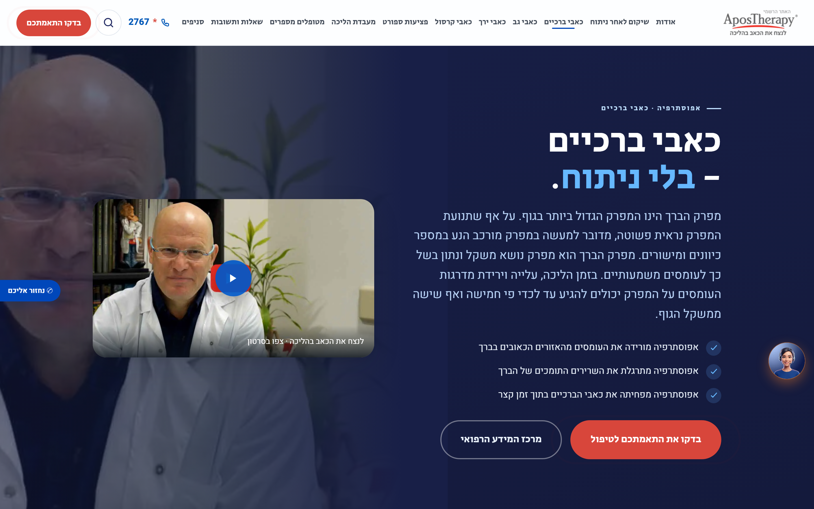</a><br><sub><b>Condition page</b> · bespoke template per condition</sub></td>
<td width="33%"><a href="docs/showcase/shots/faq-center.png">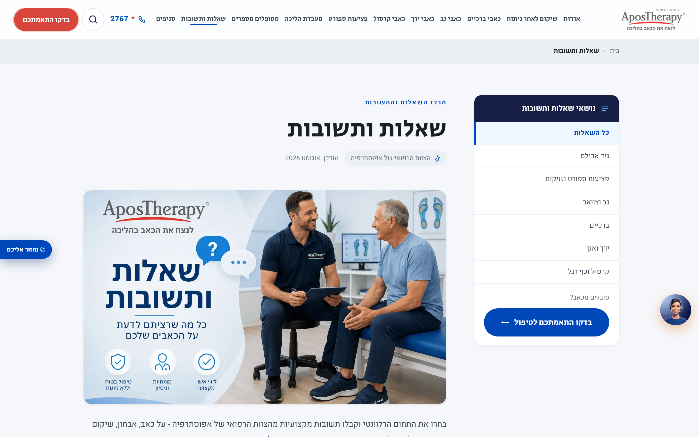</a><br><sub><b>Q&amp;A knowledge center</b> · article layout, feeds <code>FAQPage</code></sub></td>
<td width="33%"><a href="docs/showcase/shots/assistant.png">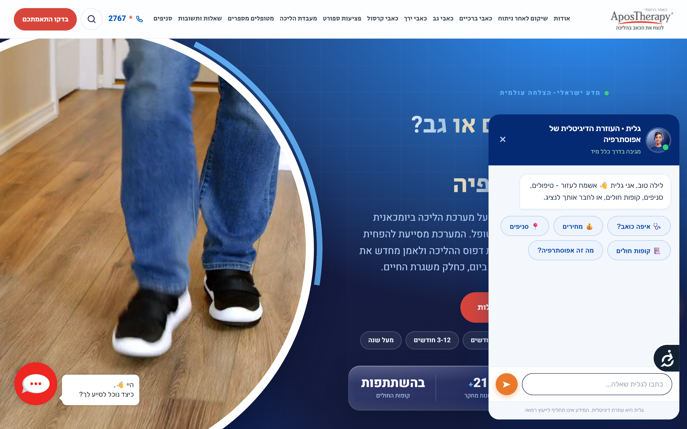</a><br><sub><b>On-site assistant</b> · self-hosted, no external AI</sub></td>
</tr>
</table>

<table>
<tr>
<td align="center"><a href="docs/showcase/shots/mobile-home.png">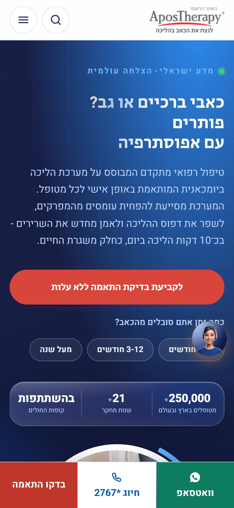</a><br><sub><b>Mobile homepage</b> · 390×844</sub></td>
<td align="center"><a href="docs/showcase/shots/mobile-menu.png">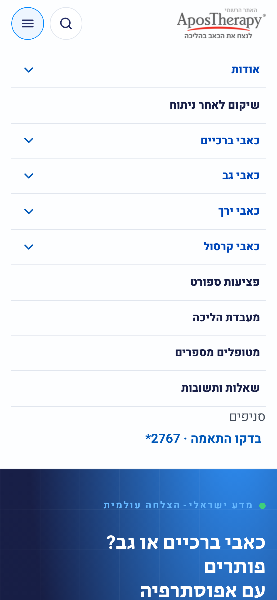</a><br><sub><b>Mobile menu</b> · RTL navigation</sub></td>
</tr>
</table>

---

## 🧭 What it is

A ground-up redesign and rebuild of a physiotherapy clinic network's website. The previous site needed a consistent look, better search visibility and a reliable way to turn visitors into leads. The solution is an **independent WordPress theme** that installs *alongside* the existing site and reuses its custom post types, ACF fields, menus and form wiring, so it was previewed on the live domain and switched on with **zero data migration and zero downtime**. A single design-token layer drives every section, pages are server-rendered for SEO, and every lead path (quiz, forms, floating form) goes through one email-first pipeline before the CRM sync.

---

## 🧩 Key capabilities

| Area | Highlights |
| ---- | ---------- |
| **Design system** | A **design-token** CSS layer (custom properties for a royal-blue scale + semantic colors) that every section reads from · fluid typography with `clamp()` · Hebrew-first pairing (**Heebo** body + **Secular One** display, `font-synthesis:none`) · glassmorphism and `backdrop-filter` · a subtle **3D tilt** on hover · one shared component language |
| **Homepage** | A **13-section** narrative page: hero with an **autoplaying muted video**, health-fund trust bar, "how it works", pain-area navigator, gait-lab feature, awards, **animated 3D stats band**, patient stories, treatment-path process, conditions grid, social proof, hand-picked articles, closing call-to-action |
| **Conversion / quiz** | A multi-step **"check your fit" modal** (בדקו התאמתכם): guided questions (pain area, duration, age group, health fund) that turn an anonymous visitor into a **qualified, contextual lead** · sticky-header and inline CTAs · a **scroll-triggered floating lead form** with a marketing-consent checkbox |
| **Lead engine** | **One pipeline** for the quiz *and* every contact form → `admin-ajax` → **email-first** delivery to the clinic + **non-blocking CRM sync** · hidden **honeypot** + **per-IP rate limit** · consent-first (unchecked marketing-consent checkbox on every form) · fully **filterable** config · a hardened **legacy endpoint** kept alive for the cache-refresh window so no lead is dropped during a deploy |
| **On-site assistant ("גלית")** | **Self-hosted, zero running cost**: no external AI API, no per-message fee, no visitor data leaving the site · answers common questions (treatments, health funds, pricing, branches, booking) from a **keyword + synonym** knowledge base · **WhatsApp / click-to-call handoff** and its own **lead-capture** path · **admin-managed** in wp-admin (master on/off, editable answers and FAQ, branch data pulled live from the CMS) · logs **unanswered questions** and 👍/👎 feedback · shows **site-wide, including future pages**, honors `prefers-reduced-motion` |
| **Q&A knowledge center** | A dedicated **שאלות ותשובות** hub plus **6 condition sub-topics** (Achilles, sports injury and rehab, back and neck, knees, hip and pelvis, ankle and foot) in the site's **article design**: sidebar topic-nav, breadcrumbs, styled accordions, **staggered scroll-reveal** · **auto-templated** by page slug/title, so any future topic inherits it · content stays **editable in wp-admin** (page body / ACF) and **feeds the auto-generated `FAQPage` schema** |
| **Accessibility** (WCAG 2.1 AA / IS 5568) | Built to **WCAG 2.1 AA / Israeli Standard 5568** · skip-to-content link · semantic landmarks · full **keyboard navigation** for the mega-menu · ARIA on interactive controls · every animation gated behind `prefers-reduced-motion` · an **external accessibility widget** for visitor adjustments · correctly sized images (no layout shift) and descriptive alt text |
| **Performance** | **LCP hero-poster preload** · DNS-prefetch · dead-CSS trimming · selective asset dequeue · poster-first, metadata-only video · zero cumulative layout shift · vanilla JS driven by **IntersectionObserver**, so nothing runs off-screen |
| **Motion & media** | **Ambient hero video** with **autoplay recovery** (retry on first gesture + IntersectionObserver + `visibilitychange` + forced-muted), so it plays even under **iOS Low Power Mode / data-saver** · scroll-reveal animations · a soft glow pulse on primary CTAs; all disabled when the visitor's device asks for reduced motion (`prefers-reduced-motion`) |
| **Security** | Response **security headers** in the theme: **HSTS**, `X-Content-Type-Options`, `X-Frame-Options`, `Referrer-Policy`, `Permissions-Policy` · **no secrets in the theme**: every credential is read from `wp-config.php` |
| **Content & templates** | Preserves the site's **custom post types** (patient stories, clinic branches), **ACF** fields and menus · bespoke templates for the about page (with practitioner bios), condition pages (knee / back / hip …), the gait lab, an at-home program, contact, research and sitemap |
| **Zero-risk rollout** | A token-based **live-preview** mechanism renders the new theme on the **production domain** for client approval (cookie-persisted across pages, cache-busting) **without activating it** or affecting real visitors · every release bumps one version constant that **also busts the asset cache** |

### Search, structured data and AI visibility

Search visibility is built into the theme itself, not added through a plugin, and extended to **AI answer engines**.

| Layer | What was built |
| ----- | -------------- |
| **Structured data** | Hand-authored **schema.org JSON-LD**: `MedicalClinic` + `LocalBusiness` (name, phone, branch addresses, service areas), `Organization`, `Physician`, `WebSite` (with `SearchAction`), `BreadcrumbList`, `MedicalWebPage`, plus an **auto-generated `FAQPage`** that reads the on-page accordion at render time, so every current *and future* FAQ feeds Google rich results with no maintenance |
| **Meta & language** | Per-page **titles + meta descriptions**, self-referential **canonical**, **hreflang** (`he` + `x-default`), full **Open Graph** + Twitter `summary_large_image`, robots directives `max-image-preview:large` and `max-snippet:-1` on every page |
| **GEO / AIO** (AI search) | A structured **`llms.txt`** for LLMs (service summary, proof points, every key page by category) + an explicit **AI-crawler allow-list** in `robots.txt` (GPTBot, ClaudeBot, PerplexityBot, Google-Extended, Applebot-Extended, CCBot …) so the clinic can surface in **ChatGPT / Gemini / Perplexity** and Google AI Overviews |
| **Indexing & discovery** | XML sitemaps (index + page + patients), verified in **Google Search Console** and **Bing Webmaster Tools**; a live per-page SEO audit confirmed unique, keyword-focused metadata across the site |
| **Email authentication** | Full anti-spoofing set at the DNS zone: **SPF + DKIM + DMARC** |

---

## 🧱 Architecture

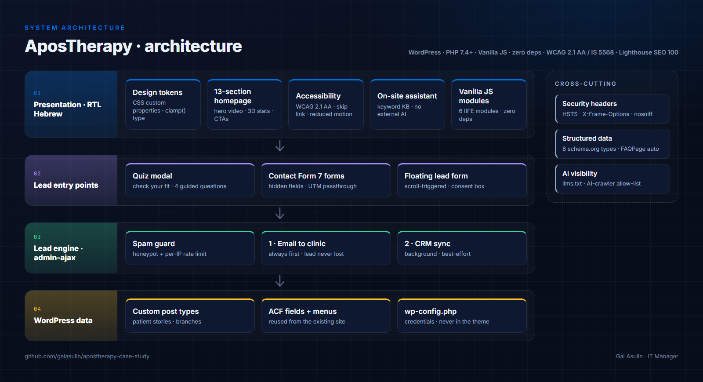

A classic **server-rendered WordPress theme** (no page builder, no client framework) sits on top of the clinic's existing data: custom post types, ACF fields and menus. The presentation layer is PHP templates plus a design-token CSS layer and isolated vanilla-JS modules. Every lead path (the quiz modal, every Contact Form 7 form and the scroll-triggered floating form) goes to **one endpoint** on `admin-ajax`. That handler runs a spam guard (hidden honeypot + per-IP rate limit), **emails the clinic first**, and only then pushes the lead to the CRM in the background. Credentials live in `wp-config.php` constants, never in the theme, and are overridable through a single WordPress filter.

### Flow

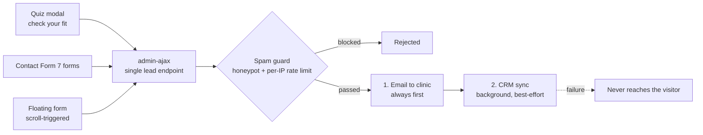

---

## 📐 Technical parameters

| Parameter | Value |
|---|---|
| Platform | WordPress, classic PHP templates, server-rendered; no page builder |
| PHP | 7.4+ |
| JavaScript | Vanilla ES6 in isolated IIFE modules; zero dependencies, zero build step |
| JS modules | 6 visitor-facing: quiz modal, floating lead form, hero-video autoplay recovery, smooth anchor-scroll, scroll-to-top, keyboard mega-menu |
| Styling | Hand-authored design-token CSS (custom properties), `clamp()` fluid type, full RTL |
| Fonts | Heebo (body) + Secular One (display), `font-synthesis:none` |
| Homepage | 13 sections |
| Q&A center | 1 hub + 6 condition sub-topics |
| Lead entry points | 3 (quiz modal, Contact Form 7 forms, floating form) → 1 `admin-ajax` handler |
| Spam protection | Hidden honeypot + transient-based per-IP rate limit |
| Integrations | Contact Form 7, ACF, clinic CRM (hidden-field injection + UTM passthrough) |
| Structured data | 8 schema.org types: `MedicalClinic`, `LocalBusiness`, `Organization`, `Physician`, `WebSite`, `BreadcrumbList`, `MedicalWebPage`, `FAQPage` (auto-generated) |
| hreflang | `he` + `x-default` |
| Security headers | HSTS, `X-Content-Type-Options`, `X-Frame-Options`, `Referrer-Policy`, `Permissions-Policy` |
| Accessibility | Israeli Standard 5568 (WCAG 2.1 AA) · skip link · keyboard navigation · `prefers-reduced-motion` · external accessibility widget |
| Lighthouse (production) | SEO **100** · Accessibility **97** · Best Practices **92** · Performance **89** mobile / ~**97** desktop |
| Indexing | **368 pages indexed**; sitemaps healthy on Google + Bing |
| Email authentication | SPF + DKIM + DMARC |
| Migration / downtime | Zero; shipped alongside the existing site |

### Results

| Metric | Result |
| ------ | ------ |
| **Lighthouse - SEO** | **100 / 100** |
| **Lighthouse - Accessibility** | **97 / 100** |
| **Lighthouse - Best Practices** | **92 / 100** |
| **Lighthouse - Performance** | **89** mobile · ~**97** desktop |
| **Accessibility standard** | Israeli Standard 5568 (WCAG 2.1 AA) |
| **Lead capture** | Email-first + background CRM sync, spam-guarded |
| **Migration / downtime** | **Zero** - shipped alongside the existing site |
| **Launch** | **Live since July 2026** - now the production site |
| **Post-launch signal** | **+15% daily organic clicks** at flat impressions (early, not yet attributable) |
| **Indexing** | **368 pages indexed**; sitemaps healthy on Google + Bing |
| **AI search readiness** | `llms.txt` + AI-crawler allow-list + rich structured data |
| **Email auth** | SPF + DKIM + **DMARC** (full anti-spoofing) |

---

## 🧠 Engineering decisions

- **Standalone theme next to the existing site** → reuses the same CPTs, ACF fields, menus and form wiring, so there is no data migration and the switch has no downtime → the new theme must stay compatible with the existing content model.
- **Capture first, sync second** → the clinic receives every lead by email before the CRM call, so a CRM outage cannot drop a lead → the CRM sync is best-effort and runs in the background; its failures never reach the visitor.
- **Self-hosted keyword assistant instead of an AI API** → no per-message cost and no visitor data leaving the site → it answers only what the knowledge base covers, so unanswered questions and 👍/👎 feedback are logged to grow it.
- **Server-rendered PHP with vanilla JS, no builder or framework** → SEO-friendly HTML, no hydration cost, no build step, no lock-in → every page type is a hand-authored template.
- **Template routing by slug/title** → the Q&A hub, its sub-topics and any future topic get the article layout with no manual setup → pages are matched by naming convention.
- **One version constant for releases** → bumping it also busts the asset cache; a hardened legacy lead endpoint stays alive through the cache-refresh window → an extra endpoint is kept for a short period after each deploy.

Delivery discipline: a **PHP lint pass across every template** before packaging, and a client hand-off pack with an illustrated **install guide**, a **performance roadmap** and an **SEO / CRO action plan**.

---

## 🚀 Landing pages

Three campaign landing pages I designed and built for the clinic network, alongside the main site. Each one has its own showcase repo with a live portfolio copy (static, tracking removed, lead form disconnected):

| Page | What is special | Repo | Live copy |
|---|---|---|---|
| **APOS4 product page** | The APOS4 system comes apart and snaps back together as you scroll: a sticky, scroll-driven frame sequence on canvas | [apos4-scroll-landing](https://github.com/galasulin/apos4-scroll-landing) | [open](https://galasulin.github.io/apos4-scroll-landing/) |
| **Research-led page** | "87% reported less pain": a CSS 3D hero you can drag, animated counters, staggered scroll reveals and an FAQ backed by structured data | [apostherapy-research-landing](https://github.com/galasulin/apostherapy-research-landing) | [open](https://galasulin.github.io/apostherapy-research-landing/) |
| **APOS4 pods page (first version)** | The pods detach from the sole and return to a personal position as you scroll: a pinned stage driven by `requestAnimationFrame` and CSS transforms on four real pod cut-outs | [apos4-pods-landing](https://github.com/galasulin/apos4-pods-landing) | [open](https://galasulin.github.io/apos4-pods-landing/) |

---

## 📁 Repository layout

```
apostherapy-case-study/
├── README.md              English case study
├── README.he.md           Hebrew case study (RTL)
├── LICENSE                All rights reserved (presentation only)
└── docs/showcase/
    ├── hero.png           Header image
    ├── architecture.png   Architecture diagram
    └── shots/             Screenshots of the live site (desktop 1440×900, phone 390×844)
```

---

## 🔐 Privacy & scope

This repository intentionally contains **no source code, no credentials, and no real data**. It exists to document the project and my role in designing, building and delivering it end-to-end. Implementation details are available on request in a suitable setting. All credentials, CRM keys and internal data were removed and are supplied through `wp-config.php`. The presentation materials are © 2026 Gal Asulin, all rights reserved; see [LICENSE](LICENSE).

---

<div align="center"><b>Built by <a href="https://github.com/galasulin">Gal Asulin</a>, IT Manager</b></div>
